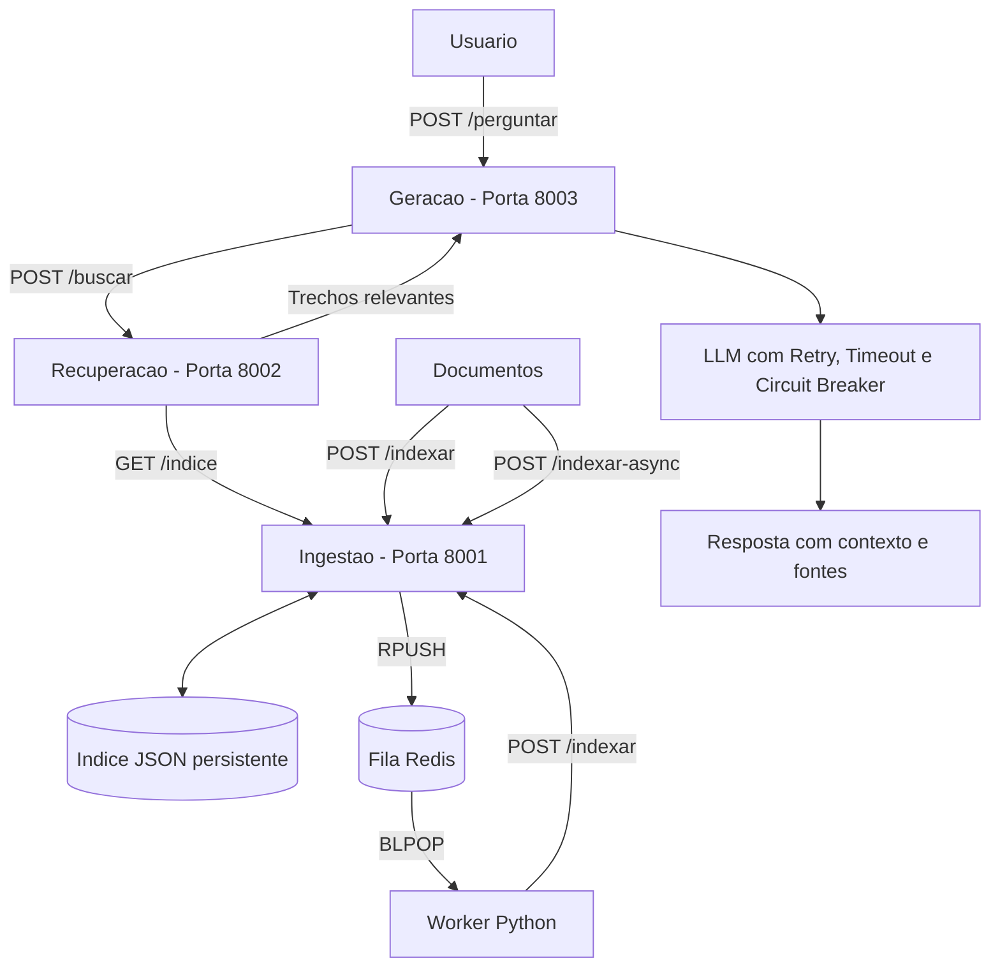

# C2.A2 — RAG Distribuído em Microsserviços

**Disciplina:** Sistemas Distribuídos e Computação em Nuvem — FAESA, 2026/2  
**Professor:** Howard Cruz Roatti  
**Repositório:** https://github.com/Julianaseith/sd-2026-2-kit-c2a2

## Visão geral

Este projeto implementa um sistema de perguntas e respostas baseado em RAG (Retrieval-Augmented Generation).

O sistema recebe documentos, gera embeddings, recupera os trechos mais relevantes para uma pergunta e utiliza esses trechos como contexto para produzir uma resposta.

O foco do trabalho é a engenharia de sistemas distribuídos, utilizando:

- Três microsserviços independentes.
- Comunicação REST.
- Mensageria assíncrona com Redis.
- Worker para processamento de documentos.
- Persistência de dados.
- Circuit breaker, timeout e retentativas.
- Docker Compose para execução reproduzível.

O cliente de LLM disponibilizado pelo kit do professor também funciona em modo simulado, sem necessidade de uma chave de API.

---

## Arquitetura



A arquitetura possui dois fluxos principais.

### Fluxo de indexação

O cliente envia documentos diretamente pela rota `POST /indexar` ou utiliza a rota `POST /indexar-async`.

Na indexação assíncrona, os documentos são enviados para uma fila Redis. O worker consome as mensagens e encaminha os documentos ao serviço de ingestão por REST.

Os documentos são armazenados em um índice JSON persistente.

### Fluxo de perguntas e respostas

O usuário envia uma pergunta ao microsserviço de geração.

A geração consulta o microsserviço de recuperação, que obtém os documentos indexados e calcula as similaridades.

Os trechos mais relevantes são utilizados como contexto para gerar uma resposta fundamentada nos documentos.

---

## Tecnologias utilizadas

- Python: linguagem principal do projeto.
- FastAPI: desenvolvimento das APIs REST.
- Uvicorn: execução dos serviços.
- Scikit-learn e TF-IDF: vetorização de documentos e perguntas.
- Redis: mensageria assíncrona.
- Docker: execução isolada dos serviços.
- Docker Compose: gerenciamento dos contêineres.
- JSON: persistência dos documentos.
- Cliente LLM do kit: geração de respostas em modo simulado ou por API.

---

## Estrutura do projeto

```text
sd-2026-2-kit-c2a2/
├── servicos/
│   ├── comum/
│   │   ├── embeddings.py
│   │   ├── llm.py
│   │   └── circuit_breaker.py
│   ├── ingestao/
│   │   └── app.py
│   ├── recuperacao/
│   │   └── app.py
│   ├── geracao/
│   │   └── app.py
│   └── mensageria/
│       ├── __init__.py
│       └── worker.py
├── documentos/
├── Dockerfile
├── docker-compose.yml
├── requirements.txt
├── .env.example
├── TAREFAS.md
└── README.md
```

---

## Microsserviços

### 1. Ingestão — Porta 8001

Responsável por receber documentos, gerar embeddings e armazenar o índice.

**Rotas:**

- POST `/indexar` — indexação direta.
- POST `/indexar-async` — envio para a fila Redis.
- GET `/indice` — consulta aos documentos indexados.
- GET `/saude` — verificação do serviço.

**Funcionalidades implementadas:**

- Recebimento de documentos.
- Geração de embeddings.
- Armazenamento em arquivo JSON.
- Carregamento automático do índice ao iniciar.
- Persistência utilizando volume Docker.
- Envio de documentos para a fila Redis.

**Status:** Implementado e testado.

### 2. Recuperação — Porta 8002

Responsável por receber uma pergunta e buscar os documentos mais relevantes.

**Rotas:**

- POST `/buscar`
- GET `/saude`

**Funcionalidades implementadas:**

- Consulta ao índice da ingestão via REST.
- Vetorização da pergunta utilizando TF-IDF.
- Cálculo de similaridade.
- Ordenação dos documentos por relevância.
- Seleção dos melhores documentos utilizando `top_k`.
- Tratamento de falhas de comunicação.

**Status:** Implementado e testado.

### 3. Geração — Porta 8003

Responsável por receber perguntas, recuperar documentos e gerar respostas fundamentadas no conteúdo.

**Rotas:**

- POST `/perguntar`
- POST `/simulacao`
- GET `/saude`

**Funcionalidades implementadas:**

- Comunicação REST com a recuperação.
- Montagem do contexto a partir dos documentos.
- Geração de respostas com o cliente LLM.
- Funcionamento em modo simulado.
- Identificação das fontes utilizadas.
- Circuit breaker.
- Timeout.
- Retentativas.
- Tratamento de erros HTTP 503 e 504.

**Status:** Implementado e testado.

---

## Mensageria com Redis

O sistema utiliza Redis para realizar indexação assíncrona de documentos.

O funcionamento ocorre da seguinte maneira:

1. A API recebe documentos pela rota `POST /indexar-async`.
2. Os documentos são enviados para a fila `fila_ingestao`.
3. O worker aguarda mensagens utilizando `BLPOP`.
4. Quando uma mensagem chega, o worker realiza uma chamada REST para `POST /indexar`.
5. A ingestão gera os embeddings e salva os documentos.
6. O índice persistente é atualizado.

A rota assíncrona retorna HTTP 202 quando a mensagem é aceita na fila.

Esse retorno não significa que o documento já foi processado. O processamento pode ser confirmado pelos logs do worker e pela consulta ao índice.

---

## Como executar o projeto do zero

### Pré-requisitos

- Git instalado.
- Docker Desktop ou Docker Engine.
- Docker Compose.

Não é necessário configurar um ambiente virtual Python para executar o projeto pelo Docker.

### Passo 1 — Clonar o repositório

```bash
git clone https://github.com/Julianaseith/sd-2026-2-kit-c2a2.git
cd sd-2026-2-kit-c2a2
```

### Passo 2 — Iniciar os contêineres

```bash
docker compose up --build -d
```

### Passo 3 — Verificar os serviços

```bash
docker compose ps -a
```

Os cinco serviços esperados são:

| Serviço | Porta |
|---|---|
| Ingestão | 8001 |
| Recuperação | 8002 |
| Geração | 8003 |
| Redis | 6379 |
| Worker | Sem porta HTTP |

Caso algum serviço apresente problemas, consulte os logs:

```bash
docker compose logs --tail=50
```

### Passo 4 — Acessar as APIs

As documentações estão disponíveis em:

- Ingestão: http://localhost:8001/docs
- Recuperação: http://localhost:8002/docs
- Geração: http://localhost:8003/docs

### Passo 5 — Indexar documentos

Acesse a API de ingestão e execute a rota `POST /indexar` com:

```json
[
  {
    "texto": "Sistemas distribuidos sao formados por computadores independentes que se comunicam por uma rede.",
    "origem": "documento_sistemas"
  },
  {
    "texto": "O Redis permite utilizar filas de mensagens para comunicacao assincrona entre microsservicos.",
    "origem": "documento_redis"
  },
  {
    "texto": "O circuit breaker interrompe temporariamente chamadas a servicos que apresentam falhas repetidas.",
    "origem": "documento_resiliencia"
  }
]
```

Uma indexação bem-sucedida retorna HTTP 200 e a quantidade de documentos indexados.

### Passo 6 — Fazer uma pergunta

Acesse a API de geração e execute `POST /perguntar`:

```json
{
  "pergunta": "Como o Redis ajuda na comunicacao entre microsservicos?"
}
```

O resultado esperado é HTTP 200 com uma resposta fundamentada nos documentos recuperados.

O sistema também informa o contexto e as fontes utilizadas.

### Passo 7 — Encerrar os serviços

```bash
docker compose down
```

Não utilize `docker compose down -v` caso deseje preservar os documentos, pois essa opção remove os volumes do Docker Compose.

---

## Teste de mensageria

Na API de ingestão, execute `POST /indexar-async`:

```json
[
  {
    "texto": "O Redis permite o processamento assincrono de mensagens em sistemas distribuidos.",
    "origem": "teste_fila_redis"
  }
]
```

O resultado esperado é HTTP 202.

Para verificar o processamento do worker:

```bash
docker compose logs --tail=30 worker
```

Em seguida, consulte a rota `GET /indice` para verificar se o documento foi armazenado.

---

## Resiliência e tratamento de falhas

O microsserviço de geração utiliza três mecanismos principais de resiliência.

### Timeout

Define um limite de tempo para a tentativa de geração.

Nos testes realizados, foi utilizado um limite de 5 segundos.

### Retry

Permite realizar novas tentativas quando ocorrem falhas transitórias.

Nos testes, o sistema conseguiu responder na terceira tentativa após duas falhas simuladas.

### Circuit Breaker

O circuit breaker interrompe temporariamente novas chamadas quando detecta falhas repetidas.

O mecanismo possui três estados:

- Closed: permite chamadas normalmente.
- Open: bloqueia temporariamente chamadas.
- Half-open: permite testar a recuperação do serviço.

O sistema foi testado com abertura do circuito após três falhas.

---

## Simulação de falhas

A rota `POST /simulacao`, no serviço de geração, permite testar os mecanismos de resiliência.

Os modos disponíveis são:

- `nenhuma`
- `transitoria`
- `timeout`
- `indisponivel`

### Teste de retentativas

Configuração:

```json
{
  "modo": "transitoria",
  "falhas": 2
}
```

Resultado observado: HTTP 200 na terceira tentativa.

### Teste de timeout

Configuração:

```json
{
  "modo": "timeout",
  "falhas": 1
}
```

Resultado observado: tratamento da falha com HTTP 504.

### Teste de circuit breaker

Configuração:

```json
{
  "modo": "indisponivel",
  "falhas": 10
}
```

Resultado observado: abertura do circuit breaker após três falhas.

O estado pode ser consultado pela rota `GET /saude`.

### Restaurar funcionamento normal

Após os testes, execute `POST /simulacao` com:

```json
{
  "modo": "nenhuma",
  "falhas": 0
}
```

O disjuntor pode precisar aguardar seu intervalo de recuperação para voltar ao estado normal.

---

## Testes realizados

### Ingestão e persistência

- Indexação de documentos com HTTP 200.
- Persistência do índice em JSON.
- Recuperação após reinicialização do servidor.
- Persistência após recriação do contêiner.

### Mensageria

- Envio de documentos com HTTP 202.
- Enfileiramento no Redis.
- Consumo de mensagens pelo worker.
- Indexação dos documentos recebidos.

### Recuperação

- Consulta pela rota POST `/buscar`.
- Cálculo de similaridade entre documentos e perguntas.
- Recuperação de documentos relevantes.
- Ordenação por pontuação.
- Seleção de resultados com `top_k`.

### Geração e resiliência

- Geração de resposta com HTTP 200.
- Utilização de documentos como contexto.
- Identificação das fontes utilizadas.
- Teste de retentativas.
- Teste de timeout com HTTP 504.
- Abertura do circuit breaker.
- Recuperação do funcionamento normal.

### Execução reproduzível

- Clonagem do repositório em uma pasta nova.
- Validação do Docker Compose.
- Construção e inicialização dos contêineres.
- Indexação de três documentos.
- Execução de pergunta pela API de geração.
- Resposta HTTP 200 com contexto e fontes.

---

## Limitações conhecidas

- O LLM utiliza modo simulado quando não existe chave de API externa configurada.
- O worker utiliza uma fila Redis simples, sem garantia de processamento exatamente uma vez.
- Mensagens podem ser perdidas se o worker encerrar durante o processamento.
- Falhas de comunicação e retentativas podem causar processamento duplicado.
- O timeout não garante necessariamente o cancelamento da operação subjacente.

---

## Critérios de avaliação

| Critério | Pontuação |
|---|---:|
| Arquitetura e decomposição em serviços | 1,5 |
| Comunicação REST e mensageria | 1,5 |
| Resiliência e tratamento de falhas | 1,0 |
| Execução reproduzível e documentação | 1,0 |
| **Total** | **5,0** |

A sofisticação do modelo de inteligência artificial não faz parte da pontuação.

---

## Contribuições do grupo

O projeto foi desenvolvido a partir do kit disponibilizado pelo professor Howard Roatti.

Kit original:

https://github.com/howardroatti/sd-2026-2-kit-c2a2

As contribuições individuais estão registradas no histórico de commits e Pull Requests do repositório do grupo.

**Repositório para entrega:**

https://github.com/Julianaseith/sd-2026-2-kit-c2a2
