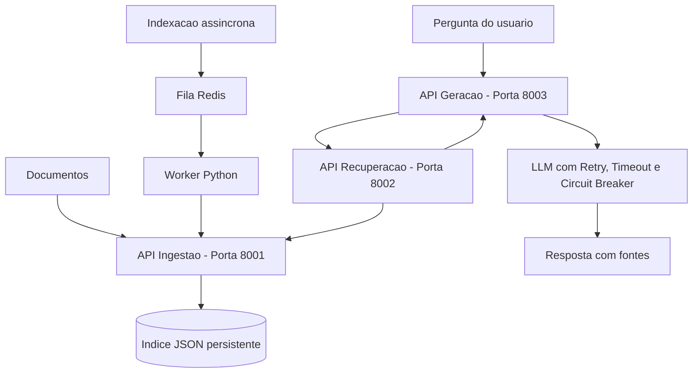

# Kit de Partida — C2.A2: RAG Distribuído em Microsserviços

**Sistemas Distribuídos e Computação em Nuvem · FAESA · 2026/2**
Prof. Howard Cruz Roatti · Lançado na Aula 8 (24/09) · Entrega na Aula 12 (29/10)

---

## O que é isto

RAG (geração aumentada por recuperação) permite que um modelo de linguagem responda
com base em documentos **seus**, sem retreinar nada. Do ponto de vista de sistemas
distribuídos é um caso perfeito: **três responsabilidades distintas** que conversam
entre si, com uma **dependência externa lenta e instável** (a API do LLM) que precisa
ser protegida.

> **Sobre a IA neste trabalho:** todo contato com inteligência artificial aqui é
> **chamada de biblioteca ou de API**. Você **não vai treinar modelos** nem precisar de
> matemática de aprendizado de máquina. O modelo já vem pronto e configurado.
> A sua nota vem da **engenharia distribuída**: arquitetura, comunicação, resiliência e
> execução reproduzível — a sofisticação do modelo **não pontua**.

---

## Como começar

```bash
# 1. Clone o kit e entre na pasta
git clone https://github.com/howardroatti/sd-2026-2-kit-c2a2.git
cd sd-2026-2-kit-c2a2

# 2. Crie e ative o ambiente virtual
python -m venv .venv
# Windows:
.venv\Scripts\activate
# Linux/macOS:
source .venv/bin/activate

# 3. Instale as dependências
pip install -r requirements.txt
```

```bash
# 4. Copie o arquivo de ambiente (funciona offline sem chave de LLM)
cp .env.example .env

# 5. Suba os três serviços, cada um em um terminal
uvicorn servicos.ingestao.app:app     --port 8001
uvicorn servicos.recuperacao.app:app  --port 8002
uvicorn servicos.geracao.app:app      --port 8003

# 6. Indexe os documentos de teste
curl -X POST http://localhost:8001/indexar -H "Content-Type: application/json" \
  -d '[{"texto":"O teorema CAP trata de consistencia e disponibilidade.","origem":"aula11"}]'

# 7. Pergunte (funciona depois da TAREFA 2)
curl -X POST http://localhost:8003/perguntar -H "Content-Type: application/json" \
  -d '{"pergunta":"o que diz o teorema CAP?"}'
```

---

## Estrutura do projeto

```
sd-2026-2-kit-c2a2/
├── servicos/
│   ├── comum/
│   │   ├── embeddings.py       # PRONTO - vetorização offline
│   │   ├── llm.py              # PRONTO - com modo simulado
│   │   └── circuit_breaker.py  # PRONTO - modelo de referência
│   ├── ingestao/app.py         # TAREFA 1
│   ├── recuperacao/app.py      # TAREFA 2
│   └── geracao/app.py          # TAREFA 3
├── documentos/                 # base de teste para indexar
├── docker-compose.yml          # TAREFA 4
└── TAREFAS.md                  # <- comece por aqui
```

---

## O que você precisa fazer

Abra o arquivo **`TAREFAS.md`**: ele lista o núcleo obrigatório item a item, indicando
o arquivo e a aula de referência de cada um.

---

## Como você será avaliado

| Critério | Pontos |
|---|---|
| Arquitetura e decomposição em serviços | 1,5 |
| Comunicação funcionando (REST / gRPC / mensageria) | 1,5 |
| Resiliência e tratamento de falhas | 1,0 |
| Execução reproduzível (README, container, deploy) | 1,0 |
| **Sofisticação do modelo de IA** | **não pontua** |
| **Total** | **5,0** |

**Entrega:** no seu repositório do GitHub, **sem apresentação oral**. Grupos livres.

---

## Aulas de referência

- **Aula 8** — Mensageria, eventos e API Gateway
- **Aula 10** — Replicação, consistência e CAP
- **Aula 11** — Consenso (Raft) e resiliência: circuit breaker
- **Aula 6** — IA como serviço (vocabulário: embedding, inferência, LLM)

---

## Dúvidas frequentes

**Preciso saber machine learning?** Não. O modelo já está pronto e você só chama uma função.

**E se eu não tiver internet no laboratório?** Tudo neste kit funciona offline. O modelo é
treinado localmente e o cliente de LLM tem modo simulado.

**Posso trocar a linguagem?** O kit é em Python porque é o ecossistema usado nas aulas.
Se quiser usar outra linguagem, converse com o professor antes.

**Posso usar IA para me ajudar a programar?** Sim. Este é um trabalho prático feito fora de
sala, e usar ferramentas de IA é realista. O que se avalia é o **sistema funcionando** e as
**decisões de arquitetura** — que você precisa saber explicar.


---

# Implementação do Grupo — C2.A2

## Objetivo

Desenvolver um sistema RAG distribuído utilizando três
microsserviços independentes, comunicação REST,
mensageria com Redis e mecanismos de resiliência.

## Arquitetura




O diagrama apresenta a arquitetura implementada com tres microsservicos independentes.

A comunicacao entre os servicos utiliza REST. A mensageria com Redis e utilizada na indexacao assincrona de documentos, com processamento realizado por um worker Python.

O sistema tambem utiliza mecanismos de resiliencia, incluindo timeout, retentativas e circuit breaker, para proteger a geracao de respostas.


O diagrama apresenta a arquitetura planejada.
A etapa de mensageria será validada na integração final.

## Tecnologias utilizadas

- Python e FastAPI: desenvolvimento das APIs REST.
- Docker: execução isolada dos microsserviços.
- Docker Compose: orquestração dos contêineres.
- Redis: infraestrutura para mensageria.
- Scikit-learn: vetorização dos documentos.
- JSON: persistência dos documentos indexados.

## Microsserviços

### 1. Ingestão

Responsável por receber documentos, gerar embeddings
e armazenar o índice.

Rotas:
- POST /indexar
- GET /indice
- GET /saude

Implementada persistência em JSON, com recuperação
automática após reinicialização.


### 2. Recuperação

Responsável por receber uma pergunta, calcular a similaridade entre a pergunta e os documentos indexados e recuperar os trechos mais relevantes.

**Rota principal:** POST `/buscar`

**Funcionalidades implementadas:**
- Consulta ao índice do microsserviço de ingestão via REST.
- Vetorização da pergunta utilizando TF-IDF.
- Cálculo de similaridade entre a pergunta e os documentos.
- Ordenação dos resultados por relevância.
- Seleção dos melhores documentos utilizando o parâmetro `top_k`.
- Tratamento de falhas de comunicação com o serviço de ingestão.

**Testes realizados:**
- Consulta de documentos pela rota POST `/buscar`.
- Recuperação de dois documentos sobre Redis.
- Verificação das pontuações de similaridade.
- Confirmação da ordenação dos resultados por relevância.

**Status:** Implementado e testado.


### 3. Geração

Responsável por receber perguntas, consultar o microsserviço de recuperação e gerar respostas fundamentadas nos documentos indexados.

**Porta:** 8003

**Rotas disponíveis:**
- POST `/perguntar` — recebe uma pergunta e gera uma resposta.
- POST `/simulacao` — configura falhas simuladas para testar a resiliência.
- GET `/saude` — informa o estado do serviço e dos circuit breakers.

**Funcionalidades implementadas:**
- Comunicação REST com o microsserviço de recuperação.
- Montagem do contexto a partir dos documentos relevantes.
- Geração de respostas utilizando o cliente de LLM do kit.
- Funcionamento em modo simulado, sem necessidade de chave de API.
- Retorno dos documentos utilizados como contexto e das fontes.
- Proteção das chamadas com circuit breaker, timeout e retentativas.

**Testes realizados:**
- Geração de resposta com HTTP 200.
- Recuperação de três documentos para fundamentar a resposta.
- Simulação de duas falhas transitórias, com sucesso na terceira tentativa.
- Simulação de timeout, com retorno HTTP 504.
- Abertura do circuit breaker após três falhas.
- Recuperação do funcionamento normal após desativar as falhas.

**Status:** Implementado e testado.


## Testes realizados

### Ingestão e persistência
- Indexação de documentos pela rota POST `/indexar`.
- Persistência do índice em arquivo JSON.
- Recuperação dos documentos após reinicialização do servidor.
- Persistência após recriação do contêiner Docker.

### Mensageria com Redis
- Envio de documentos pela rota POST `/indexar-async`.
- Confirmação de recebimento com HTTP 202.
- Enfileiramento de mensagens no Redis.
- Consumo das mensagens pelo worker Python.
- Indexação dos documentos recebidos pela fila.

### Recuperação
- Consulta pela rota POST `/buscar`.
- Vetorização e cálculo de similaridade.
- Recuperação de documentos relevantes.
- Ordenação dos resultados por similaridade.
- Seleção da quantidade solicitada por `top_k`.

### Geração e resiliência
- Geração de respostas em modo simulado com HTTP 200.
- Utilização de documentos recuperados como contexto.
- Identificação das fontes utilizadas.
- Teste de retry: duas falhas transitórias e sucesso na terceira tentativa.
- Teste de timeout: retorno HTTP 504.
- Teste de circuit breaker: abertura após três falhas.
- Teste de recuperação: retorno ao funcionamento normal com HTTP 200.

### Execução do zero
- Clonagem do repositório em uma pasta nova.
- Validação do Docker Compose.
- Inicialização dos contêineres.
- Indexação de três documentos novos.
- Execução de uma pergunta pela rota POST `/perguntar`.
- Resposta HTTP 200 com contexto e fontes.

## Limitações conhecidas

- O cliente LLM funciona em modo simulado quando não há chave de API.
- O worker utiliza uma fila Redis simples, sem garantia de processamento exatamente uma vez.
- Em determinadas falhas, mensagens podem ser perdidas ou processadas novamente.


## Participação do grupo

As contribuições individuais estão registradas
no histórico de commits e Pull Requests do GitHub.
