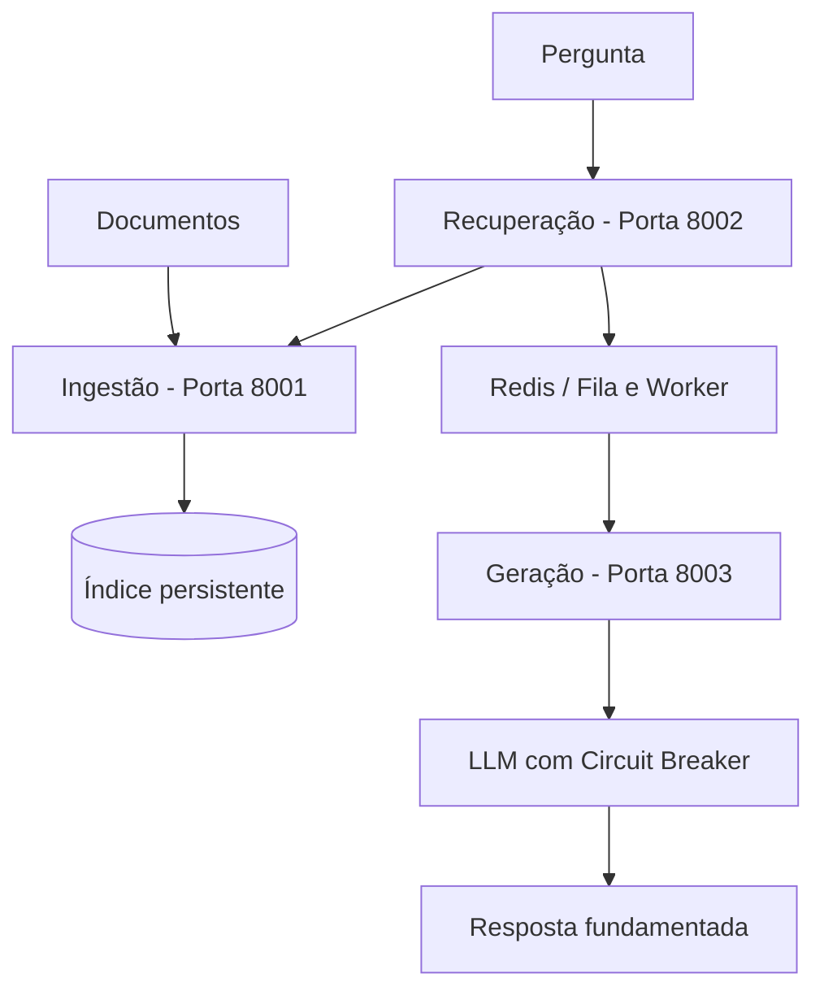

# Kit de Partida — C2.A2: RAG Distribuído em Microsserviços

**Sistemas Distribuídos e Computação em Nuvem · FAESA · 2026/2**
Prof. Howard Cruz Roatti · Lançado na Aula 8 (24/09) · Entrega na Aula 12 (29/10)

---

## O que é isto

RAG (geração aumentada por recuperação) permite que um modelo de linguagem responda
com base em documentos **seus**, sem retreinar nada. Do ponto de vista de sistemas
distribuídos é um caso perfeito: **três responsabilidades distintas** que conversam
entre si, com uma **dependência externa lenta e instável** (a API do LLM) que precisa
ser protegida.

> **Sobre a IA neste trabalho:** todo contato com inteligência artificial aqui é
> **chamada de biblioteca ou de API**. Você **não vai treinar modelos** nem precisar de
> matemática de aprendizado de máquina. O modelo já vem pronto e configurado.
> A sua nota vem da **engenharia distribuída**: arquitetura, comunicação, resiliência e
> execução reproduzível — a sofisticação do modelo **não pontua**.

---

## Como começar

```bash
# 1. Clone o kit e entre na pasta
git clone https://github.com/howardroatti/sd-2026-2-kit-c2a2.git
cd sd-2026-2-kit-c2a2

# 2. Crie e ative o ambiente virtual
python -m venv .venv
# Windows:
.venv\Scripts\activate
# Linux/macOS:
source .venv/bin/activate

# 3. Instale as dependências
pip install -r requirements.txt
```

```bash
# 4. Copie o arquivo de ambiente (funciona offline sem chave de LLM)
cp .env.example .env

# 5. Suba os três serviços, cada um em um terminal
uvicorn servicos.ingestao.app:app     --port 8001
uvicorn servicos.recuperacao.app:app  --port 8002
uvicorn servicos.geracao.app:app      --port 8003

# 6. Indexe os documentos de teste
curl -X POST http://localhost:8001/indexar -H "Content-Type: application/json" \
  -d '[{"texto":"O teorema CAP trata de consistencia e disponibilidade.","origem":"aula11"}]'

# 7. Pergunte (funciona depois da TAREFA 2)
curl -X POST http://localhost:8003/perguntar -H "Content-Type: application/json" \
  -d '{"pergunta":"o que diz o teorema CAP?"}'
```

---

## Estrutura do projeto

```
sd-2026-2-kit-c2a2/
├── servicos/
│   ├── comum/
│   │   ├── embeddings.py       # PRONTO - vetorização offline
│   │   ├── llm.py              # PRONTO - com modo simulado
│   │   └── circuit_breaker.py  # PRONTO - modelo de referência
│   ├── ingestao/app.py         # TAREFA 1
│   ├── recuperacao/app.py      # TAREFA 2
│   └── geracao/app.py          # TAREFA 3
├── documentos/                 # base de teste para indexar
├── docker-compose.yml          # TAREFA 4
└── TAREFAS.md                  # <- comece por aqui
```

---

## O que você precisa fazer

Abra o arquivo **`TAREFAS.md`**: ele lista o núcleo obrigatório item a item, indicando
o arquivo e a aula de referência de cada um.

---

## Como você será avaliado

| Critério | Pontos |
|---|---|
| Arquitetura e decomposição em serviços | 1,5 |
| Comunicação funcionando (REST / gRPC / mensageria) | 1,5 |
| Resiliência e tratamento de falhas | 1,0 |
| Execução reproduzível (README, container, deploy) | 1,0 |
| **Sofisticação do modelo de IA** | **não pontua** |
| **Total** | **5,0** |

**Entrega:** no seu repositório do GitHub, **sem apresentação oral**. Grupos livres.

---

## Aulas de referência

- **Aula 8** — Mensageria, eventos e API Gateway
- **Aula 10** — Replicação, consistência e CAP
- **Aula 11** — Consenso (Raft) e resiliência: circuit breaker
- **Aula 6** — IA como serviço (vocabulário: embedding, inferência, LLM)

---

## Dúvidas frequentes

**Preciso saber machine learning?** Não. O modelo já está pronto e você só chama uma função.

**E se eu não tiver internet no laboratório?** Tudo neste kit funciona offline. O modelo é
treinado localmente e o cliente de LLM tem modo simulado.

**Posso trocar a linguagem?** O kit é em Python porque é o ecossistema usado nas aulas.
Se quiser usar outra linguagem, converse com o professor antes.

**Posso usar IA para me ajudar a programar?** Sim. Este é um trabalho prático feito fora de
sala, e usar ferramentas de IA é realista. O que se avalia é o **sistema funcionando** e as
**decisões de arquitetura** — que você precisa saber explicar.


---

# Implementação do Grupo — C2.A2

## Objetivo

Desenvolver um sistema RAG distribuído utilizando três
microsserviços independentes, comunicação REST,
mensageria com Redis e mecanismos de resiliência.

## Arquitetura



O diagrama apresenta a arquitetura planejada.
A etapa de mensageria será validada na integração final.

## Tecnologias utilizadas

- Python e FastAPI: desenvolvimento das APIs REST.
- Docker: execução isolada dos microsserviços.
- Docker Compose: orquestração dos contêineres.
- Redis: infraestrutura para mensageria.
- Scikit-learn: vetorização dos documentos.
- JSON: persistência dos documentos indexados.

## Microsserviços

### 1. Ingestão

Responsável por receber documentos, gerar embeddings
e armazenar o índice.

Rotas:
- POST /indexar
- GET /indice
- GET /saude

Implementada persistência em JSON, com recuperação
automática após reinicialização.

### 2. Recuperação

Responsável por receber uma pergunta, calcular
similaridades e recuperar os trechos mais relevantes.

Implementação em desenvolvimento.

### 3. Geração

Responsável por utilizar os trechos recuperados para
produzir uma resposta fundamentada por meio do LLM.

Rotas:
- POST /perguntar
- GET /saude
- POST /simulacao (somente para testes de falha)

Resiliência na chamada ao LLM:
- Tempo-limite: cada tentativa é interrompida após `TIMEOUT_LLM` segundos (padrão 5).
- Retentativas: até `MAX_TENTATIVAS` (padrão 3), apenas em falhas transitórias
  (conexão, timeout, HTTP 429 e 5xx), com espera exponencial de 1s e 2s.
  Erros permanentes (ex.: 401 por chave inválida) não são repetidos.
- Circuit breaker: abre após `LIMITE_FALHAS` (padrão 3) requisições seguidas com falha,
  recusa chamadas por `ESPERA_DISJUNTOR` segundos (padrão 20) e então libera uma
  chamada de teste (meio-aberto): sucesso fecha o circuito, falha reabre.
- Erro controlado: 504 quando o LLM não responde a tempo e 503 quando está
  indisponível ou com o circuito aberto, devolvendo os trechos recuperados como fallback.
- A chamada à recuperação também é protegida por um disjuntor próprio.

#### Testes de resiliência

Falhas simuladas pela rota `POST /simulacao` (Swagger em http://localhost:8003/docs):

```bash
curl -X POST http://localhost:8003/simulacao -H "Content-Type: application/json" \
  -d '{"modo":"transitoria","falhas":2}'
```

Modos: `nenhuma`, `transitoria`, `timeout`, `indisponivel`.

| Cenário | Resultado |
|---|---|
| Normal | 200, 1 tentativa, resposta com as fontes |
| Falha transitória (2 falhas) | 200 na 3ª tentativa (~3s) |
| Timeout | 504 após 3 tentativas de 5s (~18s) |
| Indisponibilidade persistente | 503 após 3 tentativas; na 3ª requisição seguida com falha o circuito abre |
| Circuito aberto | 503 imediato, sem chamar o LLM |
| Após 20s, LLM ainda fora | chamada de teste falha e o circuito reabre |
| Após 20s, LLM de volta | chamada de teste com sucesso e o circuito fecha |
| Recuperação derrubada | 503; após 3 falhas o disjuntor da recuperação abre |

## Execução com Docker

### Pré-requisitos

- Docker Desktop
- Docker Compose
- Git

### Instalação

Clone o repositório:

```bash
git clone https://github.com/Julianaseith/sd-2026-2-kit-c2a2.git
cd sd-2026-2-kit-c2a2
```

Construa as imagens e inicie os contêineres:

```bash
docker compose up --build -d
```

Verifique os serviços:

```bash
docker compose ps -a
```

### Portas
| Serviço | Porta |
|---|---|
| Ingestão | 8001 |
| Recuperação | 8002 |
| Geração | 8003 |
| Redis | 6379 |


### Documentação das APIs

- Ingestão: http://localhost:8001/docs
- Recuperação: http://localhost:8002/docs
- Geração: http://localhost:8003/docs

### Encerrar os serviços

```bash
docker compose down
```

## Testes realizados

- Indexação de documentos via POST /indexar.
- Consulta de documentos via GET /saude.
- Persistência de documentos após reiniciar o Uvicorn.
- Inicialização dos quatro contêineres pelo Docker.
- Persistência após recriação do contêiner de ingestão.
- Resiliência do LLM: retentativas, timeout, abertura e recuperação do circuit breaker.

## Testes pendentes

- Comunicação completa entre os três microsserviços.
- Mensageria com Redis e worker.
- Fluxo completo de pergunta e resposta.
- Execução reproduzível após clonagem do zero.

## Participação do grupo

As contribuições individuais estão registradas
no histórico de commits e Pull Requests do GitHub.
